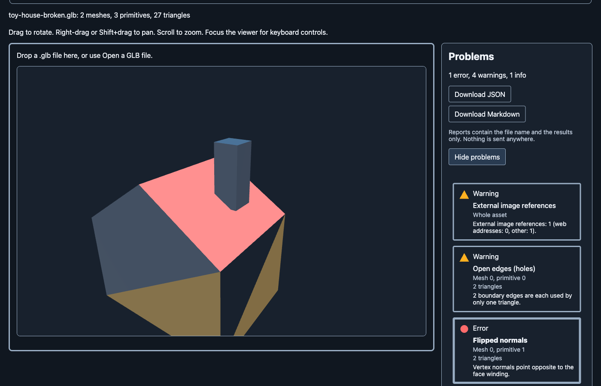
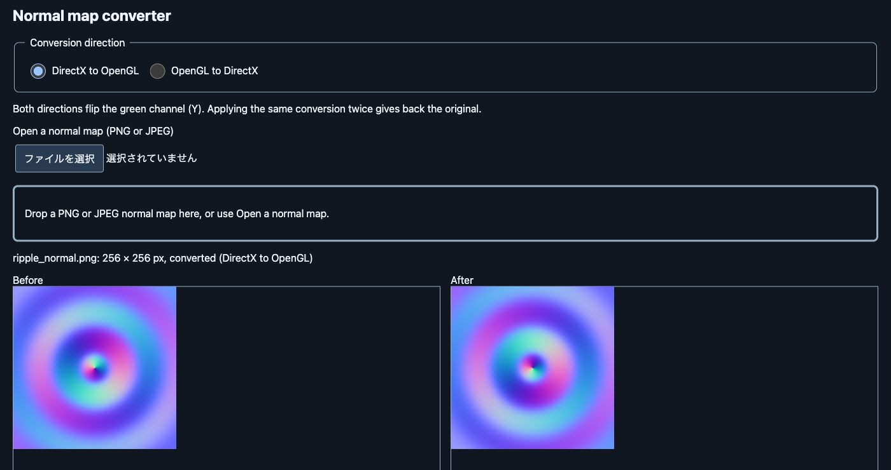
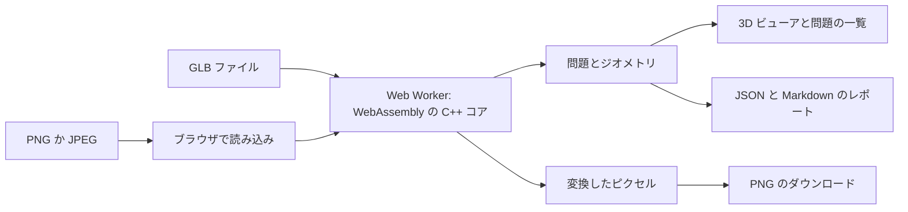

# lint-asset

[English](README.md) | 日本語

3D アセット（glTF/GLB）とテクスチャを検査する、ブラウザで動くツールです。モデルをエンジンに
取り込む前に、ジオメトリの問題を見つけ、その場所を示し、法線マップを DirectX と OpenGL の
形式の間で変換できます。ファイルは手元のブラウザの中だけで処理され、外部へ送られません。

> 状態: 開発中です。最初の公開を予定していますが、公開されたページはまだありません。
> 今は、自分で起動して使います（[ビルド](#ビルド)を参照）。



## 作った理由

DCC ツールから書き出したアセットの問題は、モデルをエンジンに入れてから見つかることが多く、
法線の反転、穴、重なった UV、スケールの違いなどで手戻りが起きます。テクスチャのチャンネルの
直し（たとえば、逆の形式で作られた法線マップ）も、画像編集ソフトで手作業になりがちです。
lint-asset は、モデルをブラウザで検査し、問題のある三角形を示し、法線マップの変換までを、
何もアップロードせずに 1 つの画面で行えるようにします。

## 機能

- **GLB の検査:** 法線（反転・欠落・長さが 1 でない）、非多様体エッジと開いたエッジ（穴）、
  面積 0 の三角形、UV（欠落・0〜1 の範囲外・重なり）、描かれる三角形の数、スケール、
  ファイルの外に保存された画像への参照を調べます。
- **問題を見る:** 3D ビューア（回転・移動・拡大縮小・ワイヤーフレーム・法線の表示）が、問題の
  三角形をモデルの上に重ね、重大度で色分けします。一覧で問題を選ぶと、カメラがそこへ移動
  します。重大度は、色だけでなく形と文字でも示し、操作はキーボードだけでもできます。
- **結果を持ち出す:** レポートを JSON（[`schemas/report.schema.json`](schemas/report.schema.json)
  に従います）か Markdown でダウンロードできます。レポートには、ファイル名・ツールの版・
  時刻・結果だけが入り、ほかにあなたやファイルの情報は入りません。
- **法線マップの変換:** DirectX から OpenGL へ、またその逆へ（緑チャンネルを反転します）。
  PNG か JPEG を読み込み、PNG を書き出します。変換前と変換後を左右に並べ、拡大と
  スクロールを連動させます。
- **サンプルを試す:** ボタン 1 つで、わざと問題を仕込んだ小さなモデルが開きます。
- **英語と日本語:** ブラウザの言語に合わせ、ページ上で切り替えられます。
- **プライバシー:** 何もアップロードせず、Cookie も使わず、アクセス解析もありません。
  ブラウザに保存するのは、言語の選択だけです。



## 使い方

1. 起動して（[ビルド](#ビルド)を参照）、デスクトップのブラウザでページを開きます。
2. 「サンプルを試す」を押すか、`.glb` ファイルをページにドロップするか、「GLB ファイルを開く」
   を使います。
3. 要約と問題の一覧を読みます。問題を選ぶと、ビューアでその場所へ移動します。
4. 必要なら、JSON か Markdown のレポートをダウンロードします。
5. 法線マップは、ヘッダーの「テクスチャ」に切り替え、PNG か JPEG をドロップし、変換の向きを
   選んで、PNG をダウンロードします。

## 検査の内容

指摘には、ルール ID（JSON のレポートでも同じ ID です）と重大度があります。

- `normal.flipped`（エラー）: 頂点の法線が、面の巻き順と逆を向いています。
- `normal.missing`（警告）: プリミティブに法線がありません。
- `normal.unnormalized`（警告）: 法線の長さが 1 ではありません（1 ± 0.01 の外）。
- `mesh.nonmanifold_edge`（エラー）: 3 つ以上の三角形が 1 本のエッジを共有しています。
- `mesh.boundary_edge`（警告）: 1 つの三角形しか使っていないエッジです（穴の縁）。
- `mesh.degenerate_triangle`（エラー）: 面積が 1e-10 未満の三角形、または有限でない位置を
  持つ三角形です。
- `uv.missing`（警告）、`uv.out_of_range`（情報）、`uv.overlap`: UV がない、UV が 0〜1 の外、
  三角形がテクスチャの同じ場所を覆っている、です。向きが同じ重なりはエラー、向きが逆の
  重なり（鏡像の配置）は警告です。
- `asset.triangle_count_exceeded`（警告）: 描かれる三角形が 100,000 個を超えています。
- `asset.scale_too_small` / `asset.scale_too_large`（警告）: 外接箱の最長辺が 0.01 m 未満、
  または 1000 m を超えています。
- `asset.external_uri`（警告）: 画像がファイルの外に保存されています。読みには行かず、
  レポートには件数だけを載せ、アドレスは載せません。

指摘は目安であり、判定ではありません。UV のないモデルが問題ない場合もあり、鏡像の UV の
配置は意図したものであることが多いです。

## 制限と既知の制約

入力:

- 読み込めるのは、1 つのバイナリ glTF 2.x ファイル（`.glb`）だけです。分割形式の glTF
  （`.gltf` と `.bin` と画像）と OBJ はまだ対応しておらず、外部のバッファを必要とするファイルは
  拒否します。
- Draco や meshopt の圧縮など、このツールが読めない拡張を必須とするファイルは拒否します。
  必須として対応している拡張は、`KHR_mesh_quantization`・`KHR_texture_transform`・
  `KHR_materials_unlit`・`KHR_texture_basisu` です。
- スパースアクセサにはまだ対応していません。
- サイズ: 100 MiB と 200 万三角形まで。その 2 倍までは、確認のうえで読み込めます。
  テクスチャは 8192 x 8192 ピクセルまで。確認のうえで、その 2 倍まで（1 辺は最大 16384
  ピクセル）です。

検査:

- ジオメトリは、各メッシュ自身の空間で調べます。ノードの変換を使うのは、描かれる三角形の数と
  スケールだけで、鏡像（負のスケール）の配置は考慮しません。
- 2 つの頂点を同じとみなすのは、位置が完全に等しいときだけで、許容誤差はありません。
  エッジは、1 つのメッシュの中のプリミティブをまたいで数えます。メッシュをまたぎません。
- 隣り合う三角形が面の向きでそろっているかは、調べません。
- UV: 最初の UV セットだけを、0〜1 の正方形だけで調べます（タイリングは調べません）。重なりは、
  三角形を 1024 x 1024 の格子に塗って、プリミティブごとに調べます。ピクセルの中心を含まない
  ほど小さい三角形は塗りません。
- しきい値（100,000 三角形、0.01 m〜1000 m）は、今は固定です。
- JSON のレポートは、常に英語です。Markdown のレポートは、ページの言語に従います。

テクスチャ:

- 画像はブラウザが読み込みます。半透明の画素は正確な色を失うことがあり、16 ビットの画像は
  チャンネルあたり 8 ビットになり、埋め込まれたカラープロファイルと EXIF の向きは無視されます。
  ページは、そのたびに警告します。不透明な 8 ビットの画像では、変換は正確です（2 回変換すると
  すべてのバイトが元に戻ります。テスト済みです）。
- 出力は PNG だけです。ORM テクスチャのパッキングと分解は未実装です。
- 8192 x 8192 の上限に近い画像のメモリ使用量は、測っていません。1 GB 前後になるかもしれません。

環境:

- デスクトップのブラウザだけで、幅 1024 px 以上のウィンドウと、WebGL2・WebAssembly・Web Worker
  が必要です。スマートフォンとタブレットにはまだ対応していません。
- 今のところ、Chromium 系のブラウザで確認しています。Firefox と Safari は、まだ確認していません。

予定していて未実装のもの: しきい値の設定、ORM のパッキング、分割形式の glTF と OBJ の読み込み、
コマンドライン版、問題ごとの直し方の目安、一覧の絞り込みと並べ替え。

## 仕組み



- `core/`: C++20 のコアです。GLB を読み（ファイルシステムと画像のデコードを切った tinygltf）、
  ジオメトリを取り出し、検査を行い、法線マップを反転します。同じコードを、テスト用にネイティブで
  （AddressSanitizer と UBSan つきで）、また Emscripten と Embind で WebAssembly にビルド
  します。どの検査も入力だけに依存するので、同じファイルからは、いつも同じレポートが出ます。
- `web/`: TypeScript のアプリです（UI フレームワークは使いません）。コアは Web Worker で動きます。
  モデルは three.js で描き、問題の三角形は自作のシェーダーで描きます。画像の読み書きは、
  ブラウザ標準の API です。
- `schemas/`: レポートのスキーマです。`web/src/wasm/lint_core.d.mts`: WebAssembly モジュールの、
  手書きの型の契約です。
- セキュリティ: ファイルは外部へ送らず、ファイルの中のアドレスも開きません。本番のヘッダー
  （`web/public/_headers`）で、Trusted Types つきの厳しい Content-Security-Policy を設定し、
  `eval` は使いません。

技術と版:

- C++20、CMake 3.24 以上、Emscripten 7.0.0、tinygltf 3.1.0（MIT）
- TypeScript 7.0.2、Vite 8.3.8、three 0.187.0、Node.js 22.12 以上
- テスト: doctest 2.4.12（ネイティブ 181 ケース。AddressSanitizer と UBSan つき）、Vitest 5.0.5
  （Web のテスト約 420 件）、スキーマ検査の Ajv 8.20.0、手で導出した期待結果との、WebAssembly の
  ビルドの照合。件数は、この文章を書いた時点のものです。
- 整形は Biome 2.6.7 と clang-format、CI は GitHub Actions（アクションはコミットで固定）
- ホスティングの予定: Cloudflare Workers の静的アセット

選んだ理由:

- C++ と WebAssembly: 検査はジオメトリの計算が中心で、同じコードを、ネイティブでテストし、
  ブラウザへ配れるからです。作者の環境では、約 100 万三角形のモデルを、およそ半秒で検査します。
- tinygltf: 小さく、単一ソースで、取り込みやすいローダーだからです。
- フレームワークなしの TypeScript と Vite: サーバー側がなく、ページが小さいからです。
- 描画は three.js、問題の重ね描きは自作のシェーダー、画像は画像ライブラリでなくブラウザ標準の
  API: 依存を減らすためです。代わりに、上の制限が生じます。

## ビルド

CMake 3.24 以上と、C++20 に対応したコンパイラが必要です。WASM のビルドには Emscripten も必要です。

ネイティブのビルドとテスト（AddressSanitizer と UBSan は、既定で有効です）:

```sh
cmake -S . -B build/native -DCMAKE_BUILD_TYPE=Debug
cmake --build build/native
ctest --test-dir build/native --output-on-failure
```

WASM のビルド（出力は `build/wasm/core/lint_core.mjs` と `lint_core.wasm` で、Web アプリ用に
`web/src/wasm/` へもコピーされます）:

```sh
emcmake cmake -S . -B build/wasm -DCMAKE_BUILD_TYPE=Release
cmake --build build/wasm
```

Web アプリ（Node.js 22.12 以上と、上の WASM のビルドが必要です）:

```sh
npm ci
npm run dev        # 開発サーバーを起動する
npm run build      # 本番ビルドを build/web に出力する
npm run check      # lint と整形の検査（Biome）
npm run typecheck  # TypeScript
npx vitest run     # Web のテスト
```

## 開発

クローンしたあと、リポジトリのフックを 1 回だけ有効にします。

```sh
git config core.hooksPath .githooks
```

フックは、ブランチ名とコミットメッセージを検査し、許可リスト（`.public-paths`）にあるパスだけが
コミットされることを確かめます。

## サンプル

`samples/` の2ファイルは `tests/tools/make_samples.py` で生成し、CC0 1.0 により
パブリックドメインに提供しています。`toy-house-clean.glb` には指摘事項がありません。
`toy-house-broken.glb` には、屋根の法線の反転、右壁の穴、鏡像配置で重なる屋根の UV、
0–1 の UV 範囲を外れた煙突の面、ファイル外に保存された画像への参照が含まれます。

## フィードバック

不具合の報告やアイデアは、[GitHub の Issue](https://github.com/nokgc333/lint-asset/issues)
で歓迎します。

## ライセンス

[MIT](LICENSE)。第三者のコンポーネントとそのライセンスは、
[THIRD_PARTY_NOTICES](THIRD_PARTY_NOTICES) にあります。
