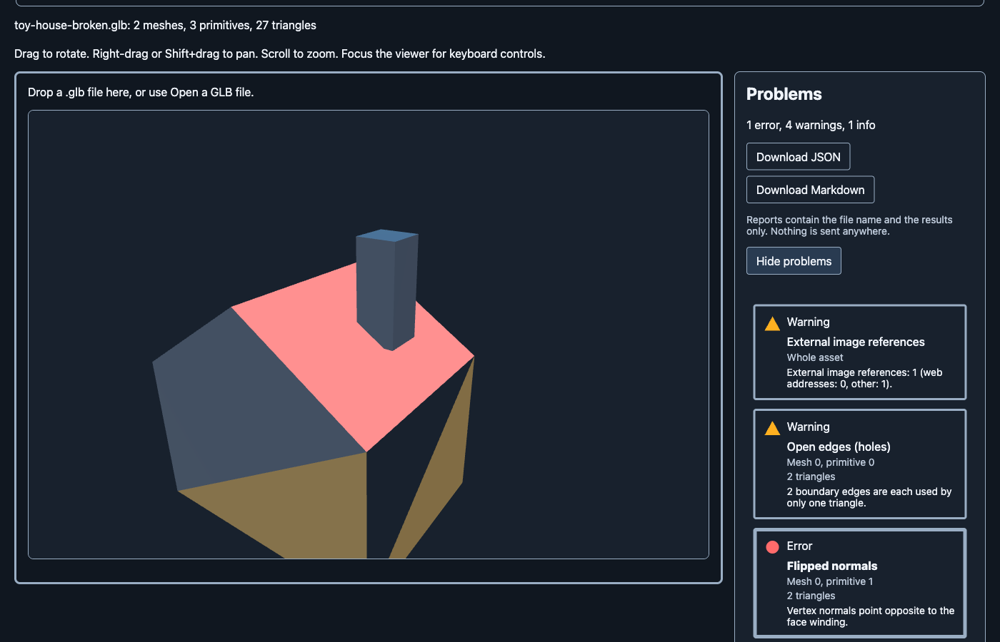
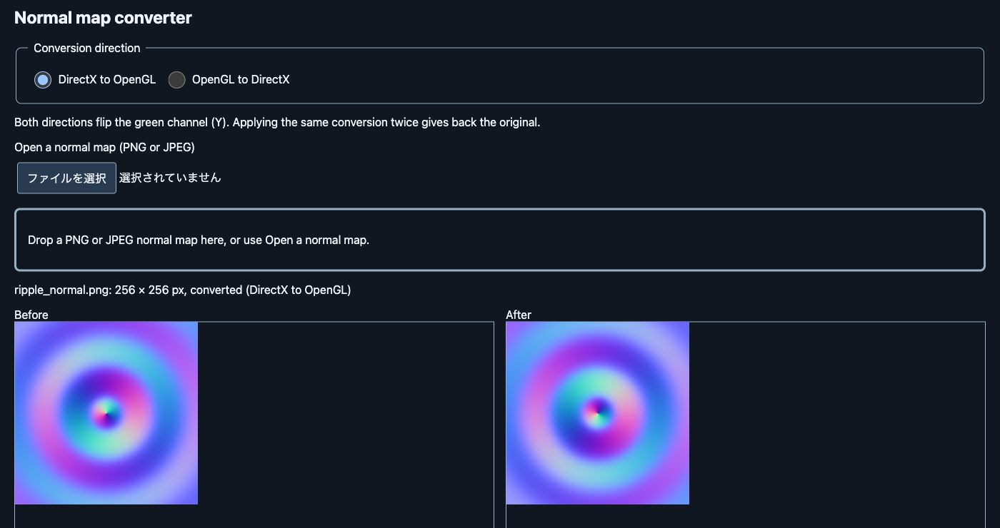
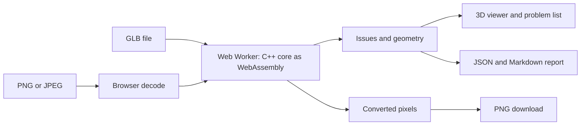

# lint-asset

English | [日本語](README.ja.md)

A browser-based linter for 3D assets (glTF/GLB) and textures. It finds geometry problems
before you import a model into an engine, shows where they are, and converts normal maps
between the DirectX and OpenGL conventions. Your files are processed locally and never
leave your browser.

> Status: in development. A first public release is planned; there is no hosted version yet,
> so for now you run it yourself (see [Build](#build)).



## Why

Problems in assets exported from a DCC tool are usually found after the model is in the
engine: flipped normals, holes, overlapping UVs, a wrong scale. Fixing a texture's channels
(for example, a normal map made for the other convention) is often done by hand in an image
editor. lint-asset checks a model in the browser, points at the triangles that are wrong, and
does the normal map conversion in one screen, without uploading anything.

## Features

- Change inspection thresholds in Settings; values are remembered in this browser.

- **Inspect a GLB.** Normals (flipped, missing, not unit length), non-manifold edges and open
  edges (holes), degenerate triangles, UVs (missing, outside 0-1, overlapping), the number of
  drawn triangles, the scale, and image references stored outside the file.
- **See the problem.** A 3D viewer (rotate, pan, zoom, wireframe, show normals) draws the
  problem triangles over the model, colored by severity. Choose a problem in the list and the
  camera moves to it. Severity is also given by shape and text, not only by color, and
  everything works from the keyboard.
- **Take the result with you.** Download a report as JSON (it follows
  [`schemas/report.schema.json`](schemas/report.schema.json)) or Markdown. A report contains
  the file name, the tool version, the time, and the results, and nothing else about you or
  your files.
- **Convert a normal map.** DirectX to OpenGL and back (it flips the green channel), PNG or
  JPEG in, PNG out, with the before and after side by side and zoom and scroll kept in step.
- **Try a sample.** One button opens a small model with deliberate problems.
- **English and Japanese.** The language follows the browser and can be switched on the page.
- **Private by design.** Nothing is uploaded, there are no cookies, and there is no analytics.
  The only thing saved in the browser is your language choice.



## Usage

1. Start it (see [Build](#build)) and open the page in a desktop browser.
2. Press "Try a sample", or drop a `.glb` file on the page, or use "Open a GLB file".
3. Read the summary and the list of problems. Choose a problem to jump to it in the viewer.
4. Download the JSON or Markdown report if you need it.
5. For a normal map, switch to "Texture" in the header, drop a PNG or JPEG, pick the direction,
   and download the PNG.

## What it checks

Each finding has a rule id (the same ids are used in the JSON report) and a severity.

- `normal.flipped` (error): the vertex normals point against the face's winding.
- `normal.missing` (warning): the primitive has no normals.
- `normal.unnormalized` (warning): normals are not unit length (1 +/- 0.01).
- `mesh.nonmanifold_edge` (error): an edge is shared by three or more triangles.
- `mesh.boundary_edge` (warning): an edge is used by only one triangle (the rim of a hole).
- `mesh.degenerate_triangle` (error): a triangle with an area below 1e-10, or a position
  that is not a finite number.
- `uv.missing` (warning), `uv.out_of_range` (info), `uv.overlap`: no UVs; UVs outside 0-1;
  triangles that cover the same part of the texture. An overlap with the same orientation is
  an error; one with the opposite orientation (a mirrored layout) is a warning.
- `asset.triangle_count_exceeded` (warning): more than 100,000 triangles are drawn.
- `asset.scale_too_small` / `asset.scale_too_large` (warning): the longest side of the
  bounding box is under 0.01 m or over 1000 m.
- `asset.external_uri` (warning): images are stored outside the file. They are never fetched,
  and the report keeps only the count, never the address.

The findings are guides, not verdicts: a model without UVs can be fine, and a mirrored UV
layout is often intended.

## Limits and known limitations

Input:

- Only a single binary glTF 2.x file (`.glb`) is read. Split glTF (`.gltf` with `.bin` and
  images) and OBJ are not supported yet; a file that needs an external buffer is rejected.
- A file that requires an extension this tool cannot read, such as Draco or meshopt
  compression, is rejected. The supported required extensions are `KHR_mesh_quantization`,
  `KHR_texture_transform`, `KHR_materials_unlit`, and `KHR_texture_basisu`.
- Sparse accessors are not supported yet.
- Size: up to 100 MiB and 2,000,000 triangles; larger files up to twice that ask for
  confirmation. Textures: up to 8192 x 8192 pixels, up to twice that after confirmation
  (and at most 16384 pixels on a side).

Inspection:

- Geometry is checked in each mesh's own space. Node transforms are applied only for the
  drawn-triangle count and the scale, so mirrored (negative scale) placements are not
  considered.
- Two vertices are the same only when their positions are exactly equal; there is no
  tolerance. Edges are counted across the primitives of one mesh, never across meshes.
- Whether neighboring triangles agree on a face direction is not checked.
- UVs: only the first UV set, and only the 0-1 square (tiling is not examined). Overlaps are
  found by drawing the triangles on a 1024 x 1024 grid, one primitive at a time, so a triangle
  too small to contain a pixel center is not drawn.
- The thresholds (100,000 triangles, 0.01 m to 1000 m by default) can be changed in Settings and are remembered in this browser.
- The JSON report is always in English. The Markdown report follows the language of the page.

Textures:

- Images are decoded by the browser. A partly transparent pixel can lose its exact color, a
  16-bit image becomes 8 bits per channel, an embedded color profile is ignored, and EXIF
  orientation is ignored. The page warns about each of these. For an opaque 8-bit image the
  conversion is exact: converting twice gives back every byte (this is tested).
- The output is PNG only. Packing and unpacking an ORM texture is not implemented.
- Memory use near the 8192 x 8192 limit has not been measured; it may be around 1 GB.

Environment:

- Desktop browsers only, in a window at least 1024 px wide, with WebGL2, WebAssembly, and Web
  Workers. Phones and tablets are not supported yet.
- So far it has been checked in a Chromium-based browser. Firefox and Safari are not checked yet.

Planned, not implemented: ORM packing, split glTF and OBJ input,
a command-line version, fix hints for each problem, and filtering and sorting the list.

## How it works



- `core/`: the C++20 core. It reads the GLB (tinygltf with the file system and image decoding
  turned off), extracts the geometry, runs the checks, and flips the normal map. The same code is
  built natively for tests (with AddressSanitizer and UBSan) and to WebAssembly with Emscripten
  and Embind. Every check depends only on its input, so the same file always gives the same
  report.
- `web/`: the TypeScript app (no UI framework). The core runs in a Web Worker. three.js draws the
  model, and a custom shader draws the problem triangles. Images are read and written with the
  browser's own APIs.
- `schemas/`: the report schema. `web/src/wasm/lint_core.d.mts`: the hand-written type contract
  of the WebAssembly module.
- Security: files are never uploaded, and addresses inside a file are never opened. The
  production headers (`web/public/_headers`) set a strict Content-Security-Policy with Trusted
  Types and no `eval`.

Technology and versions:

- C++20, CMake 3.24 or later, Emscripten 7.0.0, tinygltf 3.1.0 (MIT)
- TypeScript 7.0.2, Vite 8.3.8, three 0.187.0, Node.js 22.12 or later
- Tests: doctest 2.4.12 (181 native cases, with AddressSanitizer and UBSan), Vitest 5.0.5 (about
  420 web tests), Ajv 8.20.0 for the schemas, and checks of the WebAssembly build against
  expected results that were worked out by hand. Counts are as of this writing.
- Biome 2.6.7 and clang-format for formatting; GitHub Actions for CI (the actions are pinned
  by commit)
- Planned hosting: Cloudflare Workers static assets

Why these choices:

- C++ and WebAssembly: the checks are geometry-heavy, and the same code can be tested natively
  and shipped to the browser. On the author's machine a model of one million triangles is
  inspected in about a third of a second, and one of 100,000 triangles in about 30 ms.
- tinygltf: a small, single-source loader that is easy to vendor.
- TypeScript and Vite without a framework: there is no server side, and the page is small.
- three.js for the drawing, a custom shader for the problem overlay, and the browser's image
  APIs instead of an image library: fewer dependencies, with the limits listed above as the
  trade-off.

## Build

Requires CMake 3.24+ and a C++20 compiler. The WASM build also requires Emscripten.

Native build and tests (AddressSanitizer and UBSan are on by default):

```sh
cmake -S . -B build/native -DCMAKE_BUILD_TYPE=Debug
cmake --build build/native
ctest --test-dir build/native --output-on-failure
```

WASM build (output: `build/wasm/core/lint_core.mjs` and `lint_core.wasm`, also copied to
`web/src/wasm/` for the web app):

```sh
emcmake cmake -S . -B build/wasm -DCMAKE_BUILD_TYPE=Release
cmake --build build/wasm
```

Web app (requires Node.js 22.12+ and the WASM build above):

```sh
npm ci
npm run dev        # start the development server
npm run build      # production build into build/web
npm run check      # lint and format check (Biome)
npm run typecheck  # TypeScript
npx vitest run     # web tests
```

## Development

After cloning, enable the repository hooks once:

```sh
git config core.hooksPath .githooks
```

The hooks check the branch name, the commit message, and that only allowlisted paths
(see `.public-paths`) are committed.

To measure how long an inspection takes, generate the large test models and time them with
the WASM module built for Node.js (`-DLINT_ASSET_WASM_NODE=ON`); `--enforce` fails when a
time is over its budget:

```sh
python3 tests/tools/make_perf_models.py build/perf
node scripts/measure-inspection.mjs build/wasm-node/dist build/perf --enforce
```

## Samples

The two files in `samples/` are generated by `tests/tools/make_samples.py` and
dedicated to the public domain under CC0 1.0. `toy-house-clean.glb` has no findings.
`toy-house-broken.glb` contains a flipped roof normal, a hole in the right wall,
roof UVs that overlap in a mirrored layout, a chimney face outside the 0–1 UV
range, and an image stored outside the file.

## Feedback

Bug reports and ideas are welcome as
[GitHub issues](https://github.com/nokgc333/lint-asset/issues).

## License

[MIT](LICENSE). Third-party components and their licenses are listed in
[THIRD_PARTY_NOTICES](THIRD_PARTY_NOTICES).
